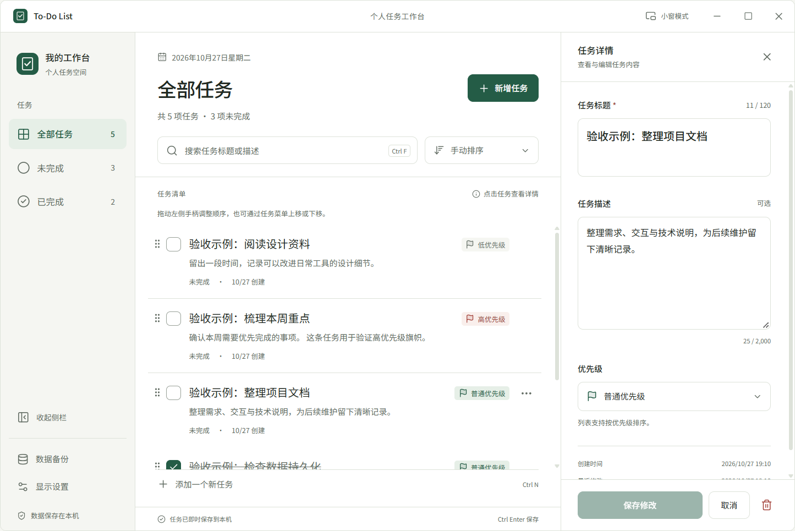

# To-Do List 桌面应用

基于 Electron、Vue 3、TypeScript、Pinia 与 SQLite 的离线任务管理工具。采用暖白与深绿视觉系统，自定义标题栏、窗口按钮和应用图标，支持主工作台及可置顶的专注小窗。

## 界面预览

**任务工作台**：列表、搜索排序、优先级旗帜与右侧任务详情。



**专注小窗**：独立显示未完成任务，支持置顶、拖动和跨窗口同步。


截图来自实际运行的应用，使用隔离的验收示例任务展示不同状态和优先级。安装版首次创建数据库时只有两条引导任务，一条已完成、一条未完成。

## Windows 安装

源码仓库不提交安装包、编译输出或本机数据。需要安装程序时，在 Windows x64 环境安装依赖并构建：

```powershell
npm ci
npm run package:win
```

构建完成后，安装程序位于 `dist/Todo-List-1.0.0-x64-Setup.exe`。运行安装向导，选择磁盘安装目录，完成安装后启动应用。安装目标仅为 NSIS，不提供便携式版本；`dist/win-unpacked` 是打包中间产物。

安装版首次启动预置两条可编辑、可删除的引导任务：一条已完成、一条未完成。仅在首次创建数据库时写入，删除后不会重新生成，也不会覆盖已有用户的数据。开发环境和普通测试默认从空列表开始。安装目录与任务数据目录分离，更新应用时继续使用原有数据；卸载默认保留任务数据。

## 主要功能

- 新增标题和可选描述，编辑、删除及 8 秒撤销，完成与恢复未完成。
- 全部、未完成、已完成筛选，标题和描述搜索，创建时间、优先级及手动排序。
- 在全部任务、无关键词、手动排序且无未保存草稿时，拖动手柄调整顺序；也可使用菜单上移下移。
- 优先级使用暖红、深绿、灰色旗帜加文字；所有选择器均为自定义组件。
- 侧栏底部展开与折叠，舒展、标准、紧凑三种密度，显示偏好持久化。
- 初始主窗口 1200 × 800，按实际工作区适配，记住后续尺寸和位置。
- 默认右下角 360 × 480 的专注小窗，可拖动、调整大小、切换置顶并快速完成任务，与主窗口实时同步。
- 工作台与小窗独立：关闭或最小化任一窗口不关闭另一个。工作台关闭后保留在系统托盘，通过托盘右键重新打开、新建任务、置顶小窗、立即备份或退出整个应用。
- SQLite 即时保存、修订冲突保护、每日与手动备份、备份恢复以及损坏数据隔离。

## 本地开发

要求 Node.js 22.12 或以上，推荐 Node.js 24，使用 npm 与项目锁文件。

```powershell
npm ci
npm run dev
```

常用检查与构建：

```powershell
npm run typecheck
npm run lint
npm test
npm run test:electron
npm run build
npm run package:win
npm run verify:package
```

npm test 使用 Electron 自带 Node 执行测试，验证与发行版相同的 SQLite 运行时。better-sqlite3 13 随包提供 Node-API 预编译模块，npmRebuild=false，安装后自动验证加载；无需为了本项目另外安装 Visual Studio 编译工具。更新图标源后运行 npm run icons 生成 PNG 和 Windows ICO。

## 数据与模块

正式数据位于用户应用数据目录下的 data/tasks.sqlite，备份位于 backups。开发使用项目 .dev-data；验收可通过 TODO_DATA_DIR 指定独立目录。任务不会保存到 LocalStorage。

src/main 管理窗口、可信 IPC、SQLite 与恢复；src/preload 只暴露具名业务方法；src/renderer 按组件与任务功能组织；src/shared 维护类型、校验和错误契约。主进程是唯一数据写入者，所有成功提示都发生在事务提交之后。

## 文档

1. [产品需求与业务规则](docs/01-product-requirements.md)
2. [界面与交互设计](docs/02-ui-ux-design.md)
3. [技术架构与数据设计](docs/03-technical-architecture.md)
4. [测试与验收基线](docs/04-testing-and-acceptance.md)
5. [分阶段实施与维护计划](docs/05-implementation-plan.md)
6. [用户操作指南](docs/06-user-guide.md)
7. [开发与维护指南](docs/07-development-guide.md)
8. [交付验证记录](docs/08-delivery-verification.md)

早期原型保留在 [design 目录](design/README.md)，用于设计追溯。正式应用以 src 与当前构建为准。

## 当前交付边界

当前交付 Windows x64 安装包，未配置代码签名证书。macOS、Linux、自动更新、账号、云同步、截止日期、标签与提醒不在本次交付范围。已规划的性能目标和完整验收基线不等同于实测结论，具体执行证据以交付验证报告为准。
