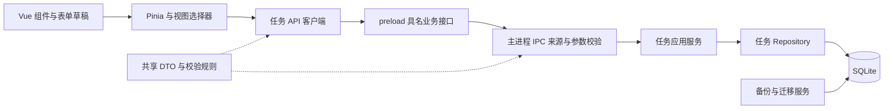
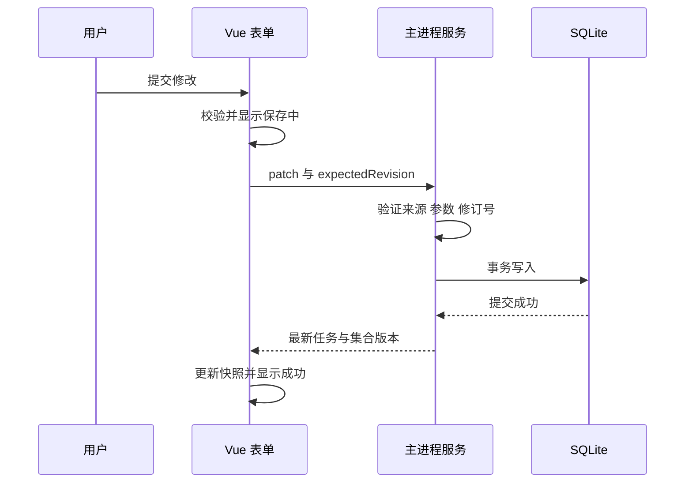

# To-Do List 技术架构与数据设计

## 架构目标

使用 Electron、Vue 3 和 TypeScript 构建单机桌面应用，以小而明确的模块边界支持持续迭代。正式数据由一个逻辑写入者管理，界面状态与持久化状态保持可验证的一致性。

采用一个主窗口及按需打开的专注小窗，同一数据目录仅运行一个应用实例，不设置后台服务或远程数据库。通过 Electron 单实例锁将后启动实例转为唤醒已有主窗口，避免多个应用实例同时管理同一数据目录。[Electron app API](https://www.electronjs.org/docs/latest/api/app)

## 技术选型

- **Electron**：桌面生命周期、窗口和系统能力。
- **Vue 3 Composition API 与 SFC**：按功能组织界面，使用 TypeScript 严格模式。Vue 官方提供 TypeScript 支持；构建还需单独运行类型检查，不能把打包通过等同于类型正确。[Vue TypeScript](https://vuejs.org/guide/typescript/overview.html)
- **Pinia**：维护已提交任务快照与跨组件视图状态，不作为正式数据源。[Vue 状态管理](https://vuejs.org/guide/scaling-up/state-management.html)
- **electron-vite**：集中构建 main、preload 和 renderer，保留独立编译边界。[electron-vite 指南](https://electron-vite.org/guide/)
- **SQLite 与 better-sqlite3**：本地事务存储。驱动封装于数据库适配层，便于后续迁至单独 Worker。
- **CSS 自定义变量与 Vue 组件样式**：保持统一设计变量，不依赖完整后台组件库覆盖产品视觉。
- **Vitest**：业务规则、窗口边界、IPC 校验和真实 SQLite 集成验证；Electron 烟雾脚本启动实际进程进行回归，另设真实 Windows 安装包与操作系统交互检查。具体执行范围记录在交付验证报告中。
- **electron-builder**：打包 Windows 安装包，未来在对应平台构建其他目标。[electron-builder](https://www.electron.build/)

依赖按兼容组合锁定于 package.json 与 lockfile，详细运行命令见 [开发与维护指南](07-development-guide.md)。升级时记录构建 Node、Electron 内置 Node、CPU 架构和 SQLite 驱动版本，不仅依据网页的 next 文档或 latest 标签判断兼容。

## 进程与调用边界



### Renderer

负责组件、表单、焦点、搜索筛选和排序展示。任务 store 保存来自主进程的已提交任务；表单草稿与任务快照分离。任务行内不编写数据库、文件或 Electron 生命周期逻辑。

首版按正常任务全量快照加载到 renderer，在目标规模下使用纯函数完成搜索、筛选与排序，避免每次输入跨进程查询。性能验证后如需分页，将查询实现迁入 API 与 Repository；组件不直接感知 SQL 或分页细节。

### Preload

仅通过 contextBridge 暴露固定的、类型化的业务接口。只做受控参数转发、结果映射和必要生命周期消息封装，不暴露任意 channel、原始 ipcRenderer、文件路径、数据库连接或 Node 对象。[Electron Context Isolation](https://www.electronjs.org/docs/latest/tutorial/context-isolation)

### Main

负责窗口、单实例、IPC 安全、任务应用服务、事务、数据库迁移、备份与恢复。主进程重新执行所有输入校验。renderer 的 TypeScript 类型和校验只能改善体验，不能替代主进程边界验证。

### 模块依赖

界面依赖 API 契约，应用服务依赖任务 Repository 的最小接口，SQLite 适配器实现该接口。共享模块只包含 DTO、枚举、校验和纯函数，不导入 Electron、Vue 或数据库驱动。main 与 renderer 之间不共享可变业务状态。

保留必要的依赖倒置，避免为每个函数增加工厂或接口。Repository 是数据边界；纯选择器无需类或服务容器。

## 计划目录

```text
src/
  main/
    index.ts
    window/
    ipc/
    tasks/                 任务应用服务和 Repository 契约
    database/              SQLite 适配器和有序迁移
    recovery/              一致快照和恢复
  preload/
    index.ts
    bridge.ts
  renderer/
    src/
      app/                 应用装配与全局错误边界
      features/tasks/      任务组件、草稿、store、选择器
      shared/ui/           按钮、字段、对话框、通知
      shared/api/          preload 适配客户端
      shared/theme/        设计变量
  shared/
    contracts/             跨进程 DTO 与错误码
    validation/            纯校验和规范化规则
tests/
  unit/
  integration/
  e2e/
docs/
```

上述目录已落实为实现。单个组件围绕一种职责组织，表单与任务行分开，不将任务和存储逻辑堆入 App.vue。主工作台与专注小窗共享 store 和任务选择器；小窗通过独立入口挂载 MiniApp，不为两个窗口引入复杂路由。

## 数据库选择与目录

SQLite 负责正式数据，JSON 仅作为未来业务导入导出的候选格式。相比 LocalStorage，主进程管理的数据库更便于实现事务、结构迁移和一致备份；相比自行维护 JSON 快照，SQLite 减少多字段更新、重排和异常恢复的自定义文件协议。该取舍针对本项目的可维护性目标，并不意味着 JSON 无法满足基本需求。[SQLite 事务](https://www.sqlite.org/lang_transaction.html)

数据位于 app.getPath('userData') 下的 data/tasks.sqlite。备份放在 backups 子目录；恢复隔离文件放在 recovery 子目录。主进程决定路径，renderer 不得传入自由文件路径。开发与测试使用独立目录，不写入正式用户数据。[Electron app 路径](https://www.electronjs.org/docs/latest/api/app)

TaskRepository 的新建库语义保持为空。打包后的正式应用由初始化入口仅为全新数据库写入两条引导任务，一条完成、一条未完成；不对已有数据、升级或用户主动删空后的集合重新填充。开发模式与仓储测试默认不写引导记录。

首版使用单连接、journal_mode=DELETE、synchronous=FULL 和 foreign_keys=ON。当前没有并发读写需求，不默认增加 WAL 管理。FULL 提高提交耐久性；可靠性仍依赖操作系统与存储设备，不能承诺抵抗所有硬件故障。[SQLite 提交机制](https://www.sqlite.org/atomiccommit.html)

### tasks

- id：文本主键，主进程生成 UUID。
- title、description：已规范化的纯文本，描述默认为空字符串。
- completed：0 或 1，数据库 CHECK 约束。
- priority：0、1、2，数据库 CHECK 约束。
- sort_order：整数顺序值，新增取当前正常任务最大值加 1，空集合从 0 开始。
- revision：正整数，创建为 1；每次修改递增。
- created_at、updated_at：UTC 毫秒。
- completed_at：可空；与 completed 保持一致。
- deleted_at、undo_token、undo_expires_at：删除时同时填写，正常任务同时为空。

重排在事务内为完整正常任务集合赋连续顺序。顺序列不设置唯一约束，因为撤销恢复时可以出现临时相同顺序值；ID 为稳定次序。

按正常与删除状态、完成状态和顺序建立必要索引。标题业务校验在共享规则和主进程执行，数据库补充非空、枚举和字段一致性约束。不对当前客户端包含搜索提前引入全文索引。

### create_requests

保留 request_id 主键、首次创建的 task_id 与 created_at，作为最小的已消费新增请求索引；不保存任务正文、完整响应或通用操作回执。创建任务与登记请求处于同一事务。

同一请求再次到达时，如果任务仍为正常任务则返回同一任务；如果已软删除或物理清理，返回 REQUEST_ALREADY_CONSUMED，不能重新创建使已删除任务复活。索引不随删除项清理而删除，task_id 因此不使用级联删除外键。该索引只在当前数据集历史中提供去重，显式恢复旧备份会回到对应历史。

### settings

使用 key、value_json 和 updated_at，保存状态筛选、排序、列表密度和侧栏折叠白名单偏好。窗口位置、尺寸、最大化及小窗置顶使用独立窗口状态文件。每项均有明确校验和默认值，禁止演化为任意业务数据容器。损坏的单个显示偏好回退默认值，不清空任务。

搜索、选中任务和表单草稿为会话状态，不跨启动恢复。

### app_meta

维护 collection_revision，任何改变正常任务内容、状态、成员或顺序的事务都递增。用于检测全局重排是否基于过期集合；它与单个任务 revision 的用途不同。

结构版本使用 PRAGMA user_version，不把应用版本号当数据库版本。新增字段通过有序迁移处理，保留旧数据默认值。

## IPC 业务契约

所有响应区分成功与失败。失败至少包含稳定错误码、用户可理解的信息和是否允许重试；开发诊断单独写入本地日志，不向界面返回数据库堆栈。

应用启动及恢复数据集后由主进程发出新的 dataEpoch。客户端在初始化快照后为所有变更附带该值；处理操作前校验，拒绝旧数据集的迟到请求。它用于生命周期一致性，不替代 IPC 来源安全校验。

### 任务方法

- **tasks.list**：无自由查询参数；返回正常任务快照、collectionRevision、dataEpoch 和仍有效的撤销元信息。任务列表与集合版本从同一一致读取得到。
- **tasks.create**：接收 createRequestId、标题、描述和优先级；返回已提交任务与集合版本。同一草稿重试沿用同一 createRequestId；主进程绑定首次创建任务，不能用同一 ID 创建不同任务。已消费且原任务被删除的请求明确拒绝。
- **tasks.update**：接收任务 ID、expectedRevision 和标题、描述、优先级 patch；不允许修改系统时间、完成状态或顺序。
- **tasks.setCompleted**：接收任务 ID、expectedRevision 和目标 completed 布尔值。使用明确目标值，不使用重复执行含义不确定的 toggle。
- **tasks.remove**：接收任务 ID 和 expectedRevision；成功返回主进程生成的撤销 token、期限和集合版本。
- **tasks.restore**：接收任务 ID 与撤销 token，由主进程校验期限，返回恢复后的任务与集合版本。
- **tasks.reorder**：接收完整正常任务 ID 列表及 expectedCollectionRevision；检查无重复、无遗漏、无未知 ID，事务内重排，返回新的完整快照和集合版本。受影响任务 revision 递增，内容更新时间不变。

设置使用独立的 settings.get 与 settings.update，更新仅接受白名单 key。恢复入口只传主进程发出的备份标识，由主进程映射到受控目录，不接收任意 SQL 或任意读写路径。

系统生成的 ID、时间、revision 和 token 不接受 renderer 覆盖。主进程对字符串长度、枚举、数组长度和总体消息大小设界限；重排消息初始最多 10,000 个 ID，超出时返回明确错误并在扩展容量前重新设计批量路径。

### 错误分类

- VALIDATION_ERROR：输入不符合要求，定位字段。
- NOT_FOUND：任务不存在或已删除，重新读取列表。
- REVISION_CONFLICT：任务或集合版本变化，保留草稿并提示刷新。
- STORAGE_BUSY：暂时无法访问数据库，允许在确认结果后重试。
- STORAGE_WRITE_FAILED：提交失败，事务回滚，保留输入。
- STORAGE_UNAVAILABLE：首次打开或读取失败，进入恢复界面。
- UNDO_EXPIRED：撤销期限已过，不在界面伪造恢复。
- REQUEST_ALREADY_CONSUMED：新增请求已使用且任务已删除，不重建任务；用户主动新建时生成新的请求 ID。
- DATASET_CHANGED：当前请求来自恢复前的数据集，清理待提交操作并重新初始化。
- UNSUPPORTED_SCHEMA：数据库结构较新，阻止旧应用写入。
- INTERNAL_ERROR：保留诊断编号，提供重试或重启路径。

本版不引入通用的跨进程操作回执表。新增通过最小 create_requests 索引去重；其他操作不盲目自动重试。若响应丢失或超时，先读取主进程快照比对实际状态，再决定是否继续。超时不能直接解释为事务失败。

## 保存一致性



写入失败时事务回滚，renderer 保持旧快照和新草稿。成功返回之前不把操作确认为完成。列表计数通过已提交快照计算，不单独维护可能漂移的计数器。

主进程按到达顺序执行写入；renderer 同一任务操作串行，避免相互覆盖。事务内部只执行同步数据库操作，文件备份、异步 I/O、等待用户确认均放在事务外。[better-sqlite3 API](https://github.com/WiseLibs/better-sqlite3/blob/master/docs/api.md)

Pinia 仅在相同 dataEpoch 内比较集合版本，只应用不早于当前集合版本的响应；若发现响应间隔导致快照缺失，则重新读取完整列表。遇到新 epoch 时先清空旧状态并加载完整快照，不能跨 epoch 用数值大小丢弃恢复结果。

## 删除与撤销实现约束

删除通过事务填写 tombstone、随机 token、deleted_at 与 undo_expires_at，并立即排除正常列表。撤销在同一事务中校验 token 和未过期状态，清空删除字段并递增修订号。

期限从主进程提交时计算 8 秒，界面倒计时仅用于显示。重启读取绝对期限，不重置窗口。清理只物理删除期限已过的 tombstone，在空闲时间或启动维护执行；清理失败不改变正常任务结果。

已删除数据可能仍存在于历史备份中。恢复旧备份会回到对应快照的任务状态，因此恢复界面必须展示备份时间和覆盖结果，不能暗中执行。

## 备份 迁移与恢复

### 正常备份

首次建立有效数据库后生成基线快照。之后启动时若已有数据且距上次成功备份超过 24 小时，生成一次备份；长时间运行的会话在空闲时补做每日检查。保留最近 7 份正常备份。

通过 SQLite Online Backup 或驱动对应备份 API 创建一致快照，先写临时目标，校验 quick_check 后再发布为可恢复备份。不得把正在使用的数据库文件简单复制并声称得到一致快照。[SQLite Backup API](https://www.sqlite.org/backup.html)

自动备份失败不回滚已提交任务；显示持久且可关闭的恢复保障提示，允许重试，并保留之前备份。日常备份只保障最近成功快照的数据，本地备份与原数据位于同一设备，不能覆盖设备整体损坏。

### 迁移

迁移前强制生成并校验保护快照，失败则不执行迁移。按版本顺序执行，每个版本变化与 user_version 更新处于同一事务。失败回滚，保留原数据并阻止继续写入。遇到高于当前支持版本的数据库时禁止降级写入。

迁移保护快照与日常轮换分开，保留最近 3 份，避免当天轮换立即删除升级前数据。

### 健康数据库恢复

用户在恢复流程中选择备份，界面显示时间与将覆盖当前任务的说明，并先处理未保存草稿。主进程进入独占恢复模式，暂停接收新变更，排空已经接收的操作，再生成当前数据库的保护快照。

在临时副本验证目标备份并完成必要迁移；通过单个事务导入受控字段，替换正常任务与设置，并恢复对应 create_requests 历史。备份中的撤销会话和删除记录不作为正常任务导入。collection_revision 使用恢复前当前值加 1，不复制备份中的旧集合版本。

成功后轮换 dataEpoch，清空 renderer 中待提交动作、旧快照、草稿与撤销入口，重新读取完整数据；旧 epoch 的请求和响应不能更新恢复后的状态。失败则回滚并继续使用当前数据，解除恢复模式。

### 损坏数据库恢复

打开或 quick_check 失败时，不创建空数据库覆盖原路径。先进入只读错误界面。用户选择恢复后，先在独立暂存位置完成备份完整校验和迁移，验证通过后关闭连接，持久化恢复阶段标记，再将原数据库及相关日志文件保存到隔离目录并受控切换正式路径。

损坏数据库可能无法读取原 collection_revision，因此使用已验证暂存数据库的集合版本加 1 作为新 dataEpoch 下的基线，不与损坏数据集的旧数值比较。切换完成并成功重新打开后才清除阶段标记，一次性发布新 dataEpoch 与完整快照，重新初始化界面。

启动时发现阶段标记、未完成隔离记录，或已有使用记录但正式数据库缺失，必须进入恢复流程，不能误判首次使用并建立空库。初次成功建库时维护独立的初始化标记。

该分支不能要求先对损坏数据库生成健康 SQL 快照，否则会阻塞恢复。原始文件必须保留；切换失败保持恢复界面，不继续空数据写入。实际文件切换与各步骤崩溃的故障注入在实现阶段专项验证。

JSON 导入导出是后续能力，不作为首版日常备份实现。启用时必须增加格式版本、大小限制、字段校验、预览和明确的合并或替换语义。

## Electron 安全边界

按 Electron 官方建议显式设置 contextIsolation 为 true、sandbox 为 true、nodeIntegration 为 false。preload 以适配沙箱的方式构建，原生 SQLite 依赖只位于 main，不进入 preload 或 renderer。[Electron 安全指南](https://www.electronjs.org/docs/latest/tutorial/security)

每个 IPC handler 验证消息来自本应用登记的窗口、该窗口的主 frame 及其受信任地址。主窗口和专注小窗按 webContents ID 独立登记；小窗不能调用主窗口关闭或最大化接口。开发服务器地址只在开发模式开放；生产只加载打包的本地资源。不开放任意导航、新窗口、webview 或未经校验的外部协议。

生产 CSP 限定本地脚本和资源，不依赖远程 CDN，不允许任务文本通过 v-html 执行。若未来增加链接打开能力，单独设置 https 协议白名单；当前纯文本任务不自动执行链接。

日志默认不记录任务标题、描述或撤销 token，只记录错误类别、操作类型、版本和耗时。备份包含任务正文，跟随本地用户数据目录权限；首版不增加隐藏的网络遥测。

## 关闭与异常生命周期

主进程接到普通工作台关闭请求后隐藏窗口，保留 renderer 与草稿，不关闭存储或小窗，也不要求用户为隐藏窗口处理草稿。小窗独立关闭，仅移除该窗口及其受信登记。

系统托盘“退出应用”设置独立退出意图，再通过工作台完成草稿保护；确认后停止接受新写入、排空任务及备份队列、关闭连接和全部窗口。通过防重入状态避免重复关闭或弹出多重提示。

renderer 无响应时由主进程原生提示提供继续等待或放弃未提交草稿后退出。主进程已接收的提交需要完成或失败后再关闭。强制终止与崩溃依赖 SQLite 恢复已提交数据，不依赖 before-quit 再保存。

## 扩展与维护方式

### 新增截止日期

新增可空 due_at 字段及迁移，更新共享 DTO 和校验，在任务表单增加独立字段组件；列表元信息组件负责显示，选择器增加相应排序。已有任务默认空日期，现有创建时间排序和完成规则不变。提醒排程是另一项能力，不与日期展示捆绑实现。

### 新增标签或多清单

标签使用 tags 与 task_tags 关联表，多清单使用独立 lists 表与关联字段；通过迁移和 Repository 扩展，避免把关系不断塞进 settings JSON。侧栏导航使用带稳定 ID 的配置，任务行与编辑器接收上下文，避免在每个组件硬编码筛选判断。

### 新增提醒

提醒由独立 reminder 模块负责持久化、系统通知和补偿规则，任务服务在提交后通知该模块。先定义休眠、重启、权限拒绝与重复提醒策略，再接系统通知；不得让 TaskRow 直接管理计时器。

### 性能扩展

better-sqlite3 常规调用是同步的。首版只在 main 执行小型事务和短查询，记录慢操作；持续主线程阻塞超过 50 毫秒时，将数据库适配器迁入单个 Worker，仍保持一个逻辑写入者。备份、批量维护和未来导入不得无界阻塞主线程。

当前规划的正常规模为 1,000 条任务，压力验证为 5,000 条，不把性能目标当作已测能力。达到容量瓶颈后再加入虚拟列表、分页或数据库搜索，保持选择器和查询契约明确。

### 变更约束

新增能力同时更新需求、契约、迁移、交互状态与验收案例。新增依赖须说明用途与维护状态；共用组件只抽取已存在的重复，不提前设计插件系统、通用流程引擎、事件总线或多数据库兼容层。

## 构建与发布风险

当前锁定的 better-sqlite3 13.0.3 随包提供 Node-API 预编译模块，不执行旧版驱动式的强制重建。electron-builder 使用 npmRebuild=false；postinstall 在实际 Electron 运行时验证 SQLite 加载。若以后替换为依赖特定 ABI 的模块，再按 Electron 版本与架构重建。安装包验证包含 .node 解包与加载、目录权限和重启留存。[Electron 原生模块](https://www.electronjs.org/docs/latest/tutorial/using-native-node-modules)

安装目标仅为 Windows x64 NSIS，允许用户选择安装目录，应用与安装程序使用自定义图标。win-unpacked 是打包流程的中间目录，不作为便携版交付。

## 主窗口与小窗同步

主进程维护受信任窗口集合。任务写入或偏好更新成功后广播完整快照，两个窗口订阅同一变化；只有主进程提交后才确认界面状态。小窗默认在当前屏幕右下角，以独立无边框窗口运行，可拖动、调整尺寸和切换置顶，位置与置顶写入独立窗口偏好文件。

小窗只显示未完成任务并允许标记完成。主窗中的未保存草稿与已提交快照分离，来自小窗的变更不覆盖草稿；保存旧修订会得到明确冲突。工作台和小窗没有父子窗口关联，关闭或最小化互不影响。

TrayController 管理系统托盘菜单与图标。关闭工作台隐藏至托盘，菜单可以重新打开任一窗口、新建任务、切换小窗置顶、备份或退出。只有明确退出意图才销毁所有窗口；不使用任务栏 JumpList 或开机自启。

数据目录与应用安装目录分离，升级保持稳定 appId 与 userData 路径。卸载与清理用户数据分开处理，默认保留数据。公开分发前配置平台签名和明确发布渠道；自动更新需单独设计版本兼容与回滚，本轮先采用手动安装包升级。
